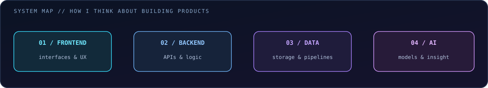

<!--
  @bacdevv | README v2 — Full-stack × AI
  Header and pipeline illustration are local SVG files.
  No external CSS or JavaScript; GitHub-compatible Markdown/HTML.
-->

<div align="center">
  
  <br />
  
  <br />
  <a href="https://github.com/bacdevv?tab=repositories"></a>
  <a href="https://www.linkedin.com/in/tr%E1%BA%A7n-vi%E1%BB%87t-b%E1%BA%AFc-a69a33327/"></a>
  <a href="mailto:vietbac.coding@gmail.com"></a>
  <br />
  
</div>

## `01 / about.me`

```typescript
const daniel = {
  name: 'Daniel Tran',
  handle: '@bacdevv',
  university: 'Industrial University of Ho Chi Minh City (IUH)',
  major: 'Computer Science',
  focus: ['Full-stack Development', 'AI / Machine Learning'],
  approach: 'Understand the fundamentals → build → test → improve',
  outsideOfCode: ['Gym', 'Learning', 'Building side projects'],
};
```

I enjoy working across the **entire software stack** — from interfaces and APIs to databases — while learning how to integrate **AI** into useful, real-world products.

- 🌐 **Full-stack:** Web applications, frontend experience, backend logic and data.
- 🧠 **AI:** Python, machine learning, computer vision and experimentation.
- 📚 **Currently learning:** System design, DSA, cloud and security fundamentals.
- ⚡ **Off-screen:** Training at the gym and learning something new every day.

## `02 / what.i.build`

<div align="center">
  
</div>

| Track                      | What interests me                                                               |
| :------------------------- | :------------------------------------------------------------------------------ |
| **Full-stack engineering** | Responsive UIs, maintainable APIs, clean data models and user-focused features. |
| **AI & data**              | Computer vision, machine learning, experimentation and data pipelines.          |
| **Engineering mindset**    | Data structures, algorithms, testing, security and scalable architecture.       |

## `03 / toolkit`

<div align="center">

**WEB / FULL-STACK**


**LANGUAGES / BACKEND**


**DATABASES / DATA**


<br />


**TOOLS / WORKFLOW**


</div>

<sub>Tools reflect a mix of current practice and topics I'm actively learning — not claims of expert proficiency in every technology.</sub>

## `04 / build.log`

```text
[ NOW ]  Full-stack projects + applied AI experiments
[ NEXT ] Better software architecture, cloud, MLOps & deployment
[ ALWAYS ] Read → build → break → debug → document → repeat
```

<a href="https://github.com/bacdevv?tab=repositories"></a>

## `05 / github.telemetry`

<!-- Dynamic cards are third-party services. Private-profile activity may be hidden. -->
<details>
  <summary><b>Open live GitHub statistics and activity</b></summary>
  <br />
  <div align="center">
    
    
    <br />
    
    <br />
    
  </div>
</details>

### `> contribution_snake`

<!-- Upload .github/workflows/snake.yml and run the action once to create these files on the output branch. -->
<div align="center">
  <picture>
    <source media="(prefers-color-scheme: dark)" srcset="https://raw.githubusercontent.com/bacdevv/bacdevv/output/github-snake-dark.svg" />
    <source media="(prefers-color-scheme: light)" srcset="https://raw.githubusercontent.com/bacdevv/bacdevv/output/github-snake.svg" />
    
  </picture>
</div>

---

<div align="center">
  <b>BUILDING PRODUCTS. EXPLORING INTELLIGENCE.</b>
  <br />
  <sub>Daniel Tran · Computer Science @ IUH · Full-stack × AI</sub>
  <br /><br />
  <a href="mailto:vietbac.coding@gmail.com"></a>
</div>
